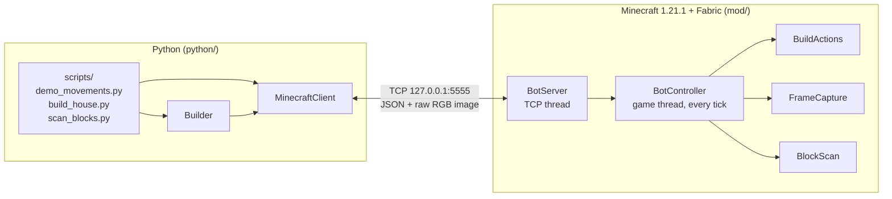

# Craftilot — project documentation

Craftilot lets a Python program drive a Minecraft player: it sends actions (move, turn, jump, place blocks…)
and gets back the player's state and, on request, an image of the game. The long-term goal is to plug machine
learning on top of it.

This folder describes the system as a whole and keeps track of what has been done. For installing and using the
project, see the [main README](../README.md) (in French).

| Document | Contents |
|---|---|
| [architecture.md](architecture.md) | The two components (Fabric mod, Python client), how they talk, and where things live. |
| [journal.md](journal.md) | What has been done so far, in chronological order, with the decisions taken. |
| [roadmap.md](roadmap.md) | Planned work, open questions and ideas. |
| [troubleshooting.md](troubleshooting.md) | Problems already met and how they were solved. |

## In one picture

## Current status

- **Mod version:** 0.2.1, for Minecraft **1.21.1** exactly (not 1.21.11 — see [troubleshooting](troubleshooting.md)).
- **Works:** moving the player, turning the camera, capturing frames, creative mode, flying, placing and breaking
  blocks, building a small house automatically, reading the world's blocks (`get_blocks`, `get_chunk`,
  `get_blocks_around`).
- **Next:** see the [roadmap](roadmap.md).

## Keeping these docs up to date

When something changes, add an entry to [journal.md](journal.md), and update [architecture.md](architecture.md)
if a component, a command of the protocol or a version changed.
